# Crypto Ticker 2.0

Crypto prices on an RGB LED matrix driven by a Raspberry Pi. This is an updated
version of the [Howchoo crypto ticker](https://howchoo.com/pi/raspberry-pi-cryptocurrency-ticker)
for current Raspberry Pi OS. The hardware is the same; the software is rewritten.

| `LAYOUT=classic` | `LAYOUT=chart` |
|--|--|
| 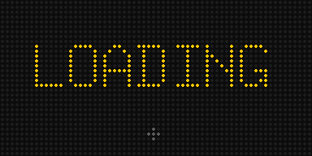 |  |

Each coin screen shows the coin's icon, ticker, 24h change with ▲/▼, a 7-day chart and the
price (auto-sized: `$109,235`, `$4,012.37`, `$0.0₄1123`). Each cycle can also show a **clock**
with the weather, the crypto **Fear & Greed index**, and a **market indices** page, and optionally a
**weather** screen, scrolling **news headlines** and **sports scores**. Screens scroll up into each
other (or slide sideways, or switch instantly). Everything can be changed from your phone.

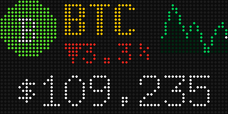

More screenshots (rendered by the emulator) are in [`docs/screenshots/`](docs/screenshots/):

| Coin | Featured | List view (4) | List view (5) | Stale prices | No data |
|--|--|--|--|--|--|
| 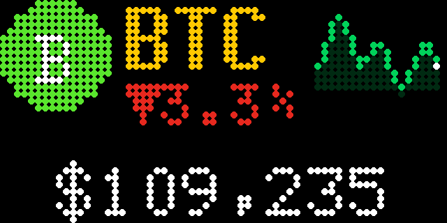 | 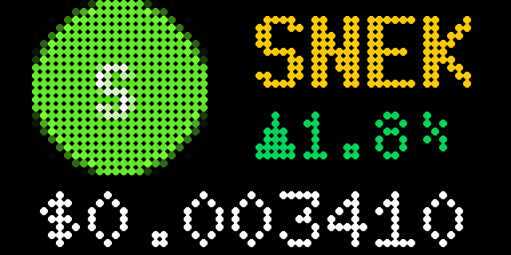 | 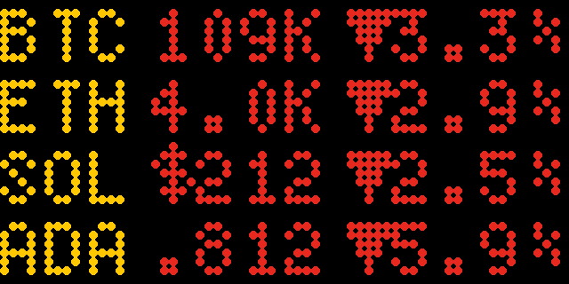 | 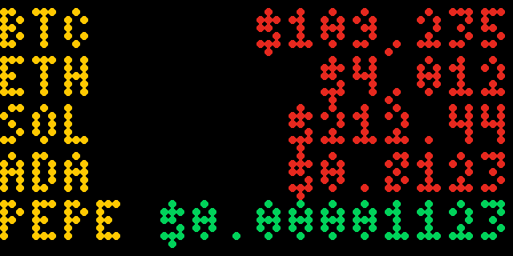 | 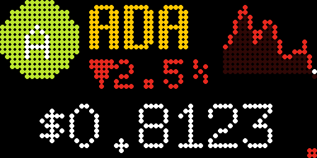 | 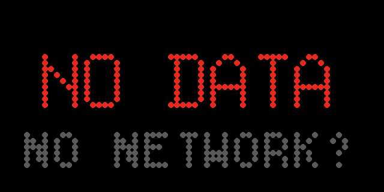 |

| Weather | News | Videos | Sports: live | Sports: college | Sports: final | Sports: upcoming |
|--|--|--|--|--|--|--|
| 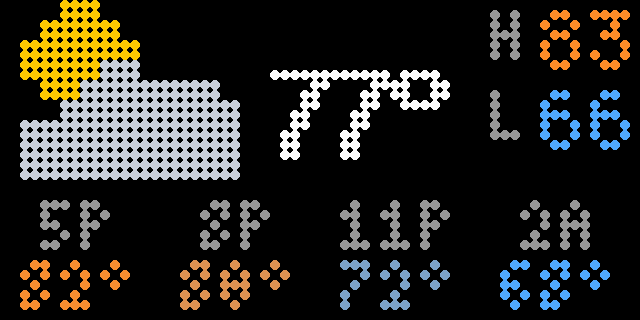 | 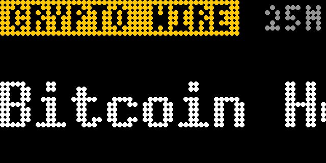 | 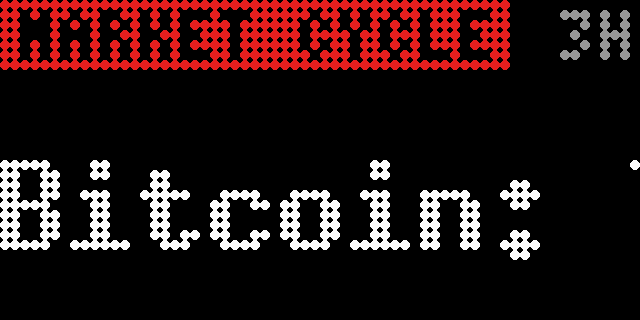 | 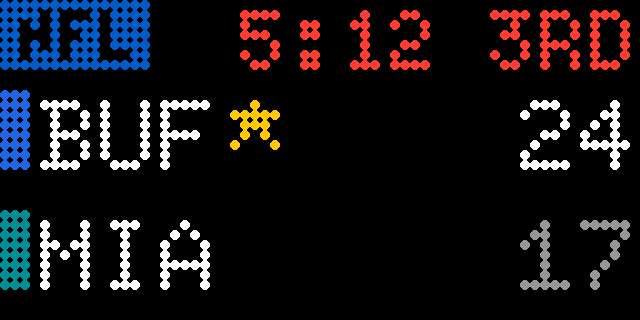 | 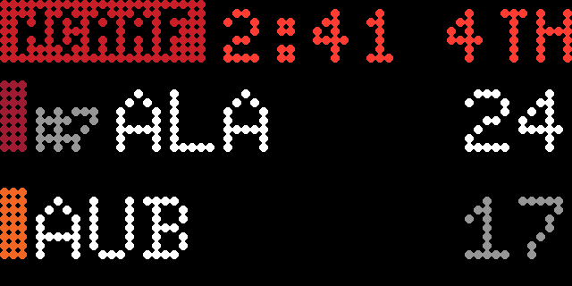 | 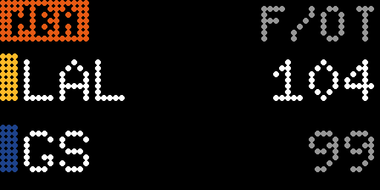 | 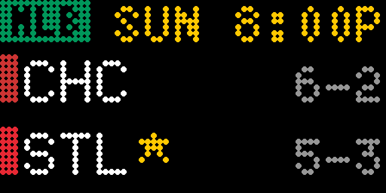 |

## Contents

1. [Hardware](#hardware)
2. [Wiring check](#wiring-check)
3. [Install](#install)
   - [Other Wi-Fi networks (phone hotspot)](#other-wi-fi-networks-phone-hotspot)
   - [Work Wi-Fi (WPA2-Enterprise)](#work-wi-fi-wpa2-enterprise)
4. [Configuration](#configuration)
5. [Weather, news, videos and sports screens](#weather-news-videos-and-sports-screens)
6. [Phone settings page](#phone-settings-page)
7. [Updating (and rolling back)](#updating-and-rolling-back)
8. [iPhone widget](#iphone-widget)
9. [Running without hardware (emulator)](#running-without-hardware-emulator)
10. [How failures are handled](#how-failures-are-handled)
11. [Troubleshooting](#troubleshooting)
12. [Development](#development)
13. [Screenshots](#screenshots)

## Hardware

- Raspberry Pi Zero W / WH (also works on Pi 3, 4 and 5)
- Adafruit 64×32 RGB LED matrix panel (HUB75). 64×64 and chained panels also work
- Adafruit RGB Matrix Bonnet (or HAT)
- 5 V power supply, **4 A or more**, with a 2.1 mm barrel plug
- microSD card, 8 GB or larger

## Wiring check

Do this with the power **unplugged**.

1. **Bonnet on the Pi.** Press the bonnet onto all 40 GPIO pins. Look from the side: no pins
   should show on either end, and the board should sit flat.
2. **Ribbon cable.** Plug the 16-pin ribbon from the bonnet into the panel's **INPUT** connector
   (the one the printed arrows point *away* from). The plugs are keyed; don't force them.
3. **Panel power.** Connect the panel's red/black power lead to the bonnet's screw terminal:
   **red to +5V, black to GND**. Double-check this; reversed polarity can damage the panel.
4. **Power supply.** The 5 V supply goes into the bonnet's barrel jack. The bonnet also powers
   the Pi through the header, so you don't need the Pi's own USB power.
   A Pi's USB port can't power the panel.
5. **Jumpers.** For a 64×32 panel, leave the bonnet's "E" address jumper alone (it's for 64×64
   panels). If you soldered the optional PWM jumper (GPIO4 to GPIO18), set
   `LED_GPIO_MAPPING=adafruit-hat-pwm`.

After installing (below), run the test pattern:

```bash
sudo systemctl stop crypto-ticker
sudo ./venv/bin/python ticker.py --test-pattern
```

It shows solid **red, green, blue, white**, then a white border with colored corners
(red top-left, green top-right, blue bottom-left, yellow bottom-right) and the panel size.

| What you see | Fix |
|--|--|
| Colors swapped (red shows as blue, etc.) | Set `LED_RGB_SEQUENCE` (e.g. `RBG`, `GRB`) |
| Only the top or bottom half lights, or rows repeat | Check the ribbon is in **INPUT**; check `LED_ROWS` / `LED_COLS` |
| Flicker, sparkles or garbled pixels | Raise `LED_SLOWDOWN_GPIO` by 1 |
| Nothing at all | Check the 5 V supply and the red/black power lead, then the log |
| Dim or brownouts on white | Use a stronger supply (4 A+), or lower `BRIGHTNESS` |

## Install

1. Flash **Raspberry Pi OS Lite** (Bookworm or newer) with Raspberry Pi Imager. Use the 32-bit
   version on a Pi Zero W/WH. In Imager's settings set a hostname, a username and password,
   Wi-Fi (a Pi Zero W only does **2.4 GHz**), your time zone, and enable SSH.
2. Boot the Pi and SSH in: `ssh <user>@<hostname>.local`
3. Install:

   ```bash
   sudo apt-get install -y git
   git clone https://github.com/DNA2RNA1/crypto-ticker.git
   cd crypto-ticker
   ./install.sh
   ```

   `install.sh` installs packages, creates a Python virtual environment, builds the LED library
   (**20–40 minutes on a Pi Zero**; leave it running), turns off onboard audio (it conflicts
   with the panel timing), caps the system journal at 16 MB, asks for a 4–8 digit PIN for the
   phone settings page, and installs a systemd service that starts the ticker at boot.
   It's safe to run again; it keeps your `settings.env`.

   Options: `--pin 1234` (no prompt), `--no-pin`, `--skip-build` (don't rebuild the LED
   library), `--no-service` (don't enable auto-start).
4. Pick your coins: `nano settings.env`
5. `sudo reboot`. The ticker starts on its own.

| Task | Command |
|--|--|
| Is it running? | `sudo systemctl status crypto-ticker` |
| Live log | `journalctl -u crypto-ticker -f` or `tail -f logs/ticker.log` |
| Apply hand edits to settings.env | `sudo systemctl restart crypto-ticker` |
| Update | **Update** button on the phone page, or over SSH: `git pull && ./install.sh --skip-build && sudo systemctl restart crypto-ticker` |
| Stop / start at boot | `sudo systemctl disable --now crypto-ticker` / `sudo systemctl enable --now crypto-ticker` |
| Health check (changes nothing) | `./doctor.sh` |
| Save another Wi-Fi network / list them | `./install.sh --add-wifi` / `./install.sh --list-wifi` |

**First run tip:** start minimal (`SCREENS=coins`, `WEB_ENABLED=false`), get prices on the panel,
then turn features back on one at a time and watch the log after each.

### Other Wi-Fi networks (phone hotspot)

To take the ticker somewhere else, save another ordinary Wi-Fi network (WPA2/WPA3-Personal, or open),
for example your phone's hotspot:

```bash
./install.sh --add-wifi
./install.sh --list-wifi
```

`--add-wifi` asks for the network name and password (typed twice, not shown; Enter for an open
network) and whether it's hidden. It saves a root-only NetworkManager profile named
`ticker-wifi-<name>` and doesn't switch networks now, so your SSH session stays up; the Pi joins it
whenever it's in range, and prefers your home network if both are. The password never appears on a
command line. `--list-wifi` shows every saved network (no passwords), which one is connected, and what
else is in range. To remove one: `sudo nmcli connection delete ticker-wifi-<name>` (the name is shown
in brackets by `--list-wifi`). Normal installs never touch Wi-Fi settings.

### Work Wi-Fi (WPA2-Enterprise)

To take the ticker to work, add a second Wi-Fi profile for a WPA2-Enterprise network that uses
**PEAP with MSCHAPv2** (a username and password, the common setup for company Wi-Fi). Your home
Wi-Fi stays exactly as it is; NetworkManager (standard on Raspberry Pi OS Bookworm) joins whichever
network is in range, and prefers home if both are.

```bash
./install.sh --enterprise-wifi
```

It asks for the network name, your username and password (typed twice, not shown), an optional
anonymous (outer) identity, and how to check the network's server:

1. **A CA certificate file** from your IT department (best). Optionally also the server's domain
   name (e.g. `radius.example.com`).
2. **The system's trusted certificates plus the server's domain name**, if the network's server uses
   a certificate from a public authority.
3. **Skip the check.** Only if you can't get the certificate. Without it, anything broadcasting the
   same network name can collect your username and an MSCHAPv2 exchange that can be cracked offline
   to recover your password. You have to type `skip` to confirm.

To remove the profile again (the certificate copy too):

```bash
./install.sh --remove-enterprise-wifi
```

Running it again replaces the profile. A normal `./install.sh` never touches Wi-Fi settings; only
these two options do, and they change nothing else.

**Where the password goes.** The profile is one NetworkManager file,
`/etc/NetworkManager/system-connections/ticker-work-wifi.nmconnection`, readable only by root
(mode 600); a certificate you supply is copied to `/etc/crypto-ticker/work-wifi-ca.pem`. The
password is stored there in plain text: NetworkManager can't log in to PEAP/MSCHAPv2 with an NT
hash (it hands the password to wpa_supplicant over D-Bus, and wpa_supplicant only accepts the
`hash:` form in its own config files). Anyone who can read the SD card can read it, so treat the card
like a key, and if your work password is also your company login, consider asking IT for a
separate device account. The password is never written into this repository, a command line or
the logs.

**At work, the phone settings page may not be reachable.** Company networks often keep devices from
seeing each other (client isolation), block the `.local` names the page uses, or put phones and
other devices on different networks. Change settings at home, or ask IT. Also on a work network:
the price, weather, news and sports sources may be blocked by a firewall or proxy (the panel then
shows the last good data, marked stale), and the **Update** button may not reach GitHub if outgoing
SSH (port 22) is blocked.

To check it: `nmcli connection show` lists `ticker-work-wifi`; `nmcli device wifi list` shows which
networks the Pi can see; `journalctl -u NetworkManager -b | grep -i 802-1x` shows why a login failed
(wrong password, or the certificate check failed).

## Configuration

All settings live in `settings.env` (created from `settings.env.example`, which documents every
option). Most can also be changed from the phone page. A typo doesn't stop the ticker: an invalid
value is logged as a warning and the default is used.

| Name | Default | What it does |
|--|--|--|
| `SYMBOLS` | starter list | Coins in order. `ada:cardano` pins an exact CoinGecko id |
| `CURRENCY` | `usd` | `usd`, `eur`, `gbp`, `cad`, `aud`, `jpy` |
| `COINGECKO_API_KEY` | | Optional free Demo key (steadier rate limits) |
| `REFRESH_RATE` | `auto` | `auto` (as fast as once a minute within the monthly budget) or seconds, min 60 |
| `MONTHLY_CALL_BUDGET` | `10000` | CoinGecko calls per month (free Demo plan: 10,000) |
| `SLEEP` | `5` | Seconds per coin screen |
| `TRANSITION` | `scroll` | `scroll` (old screen moves up, new one rolls in from the bottom), `slide` (sideways) or `none`. Both animations take about 0.45 s and apply to every screen change, including List view pages |
| `LAYOUT` | `classic` | `classic` (icon + mini chart), `chart` (full-screen chart), `mix` |
| `FEATURED` | | Starred coins: get a big-picture screen before their price |
| `FOCUS` | `off` | `on` = coin rotation shows only starred coins, one big-picture screen each (clock, Fear & Greed and indices keep running). With nothing starred, all coins show |
| `LIST_VIEW` | `off` | `off`, `4` (pages of 4: price + % change; the phone page's switch turns this on) or `5` (pages of 5 coins: ▲/▼ + price). Starred coins keep their big screens |
| `LIST_PAGE_SECONDS` | `6` | Seconds per list page (2–60) |
| `SCREENS` | `clock,feargreed,indices,coins` | Screens at the start of each cycle, in order (coins always last). Also `weather`, `news`, `videos`, `sports` (off by default) |
| `INDICES_SOURCE` | `coingecko` | `coingecko` (tokenized funds, no extra calls) or `yahoo` (real index values; unofficial) |
| `NEWS_FEEDS` | three crypto/business feeds | RSS or Atom URLs, comma separated (one per line on the phone page), up to 8 |
| `NEWS_PER_CYCLE` | `3` | Headlines shown each cycle (1–10); the next cycle continues where this one stopped |
| `NEWS_SPEED` | `normal` | Headline scroll speed: `slow` (20), `normal` (30) or `fast` (45 pixels/s); video titles use it too |
| `VIDEOS_CHANNELS` | (none) | YouTube channels as `UC…` ids or `@handles`, comma separated, up to 10. Paste channel links on the phone page and it converts them |
| `VIDEOS_PER_CYCLE` | `3` | Video titles shown each cycle (1–10) |
| `VIDEOS_MAX_AGE_DAYS` | `3` | Only uploads from the last N days (1–30) |
| `VIDEOS_SKIP_SHORTS` | `on` | Leave out YouTube Shorts (detected by their `/shorts/` link) |
| `SPORTS_<LEAGUE>` | `on` (`off` for NHL) | `SPORTS_NFL`, `SPORTS_NCAAF`, `SPORTS_NBA`, `SPORTS_NCAAM`, `SPORTS_MLB`, `SPORTS_NHL`: `on`/`off` |
| `SPORTS_<LEAGUE>_TOP` | `25` college, `8` pro | Follow the AP Top `10`/`25` (college) or the top `4`/`8`/`12`/`16` by record (pro); `0` = off |
| `SPORTS_<LEAGUE>_FAVORITES` | (none) | Favorite teams as ESPN `id:ABBR` pairs, e.g. `2:BUF`; easiest to pick on the phone page |
| `INDICES_VIEW` | `percent` | `percent`, or `both` to flip to the $ / point change halfway through. With `coingecko`, S&P and Nasdaq are fund prices ($ per share), not index points |
| `TIMEZONE` | Pi's setting | Clock and night-dimming time zone, e.g. `Europe/London` |
| `WEATHER_PLACE` / `WEATHER_LAT` / `WEATHER_LON` / `TEMP_UNIT` | example values | Weather on the clock; easiest to set by ZIP code or city on the phone page |
| `BRIGHTNESS` | `70` | 1–100 |
| `DIM_HOURS` / `DIM_BRIGHTNESS` | `22-7` / `15` | Night dimming window (24 h clock) and its brightness |
| `DOWNLOAD_ICONS` | `true` | Fetch coin icons automatically |
| `WEB_ENABLED` / `WEB_PORT` / `WEB_PIN` | `true` / `8080` / asked at install | Phone settings page |
| `LED_ROWS` / `LED_COLS` / `LED_CHAIN` | `32` / `64` / `1` | Panel size and how many are chained |
| `LED_GPIO_MAPPING` | `adafruit-hat` | `adafruit-hat-pwm` if you soldered the PWM jumper |
| `LED_SLOWDOWN_GPIO` | `1` | Pi Zero 0–1, Pi 3 ≈2, Pi 4/5 ≈4. Raise it if the panel flickers |
| `LED_RGB_SEQUENCE` | `RGB` | Change if colors are swapped |
| `LOG_LEVEL` | `INFO` | `DEBUG`, `INFO`, `WARNING`, `ERROR` |
| `LOG_FILE` | `logs/ticker.log` | Rotating log file; blank = journal only |
| `LOG_MAX_KB` / `LOG_BACKUPS` | `512` / `3` | Log rotation: at most ~2 MB on the SD card |
| `UPDATE_REMOTE` | SSH form of `origin` | Where the Update button pulls from, e.g. `git@github.com:owner/crypto-ticker.git` |
| `UPDATE_SSH_KEY` | `~/.ssh/crypto-ticker-deploy` | Deploy key the Update button uses |

**Custom icons:** tap a coin's picture on the phone page and choose a photo, or copy a PNG to
`icons/<symbol>.png`. Your pictures stay on the Pi (they're not committed to git).

## Weather, news, videos and sports screens

Turn them on in the phone page's **Screens** list and move them with ↑/↓. Each one comes in and
goes out with your Transition setting, and each is skipped (never an error screen) when it has
nothing to show.

**Weather** uses the same Open-Meteo data and location as the clock (set by ZIP code or city on the
phone page) and the °F/°C setting: a big current temperature, a condition icon, today's high
(orange) and low (blue), and a line of the next 12 hours' temperatures along the bottom.

**News** shows one headline at a time, scrolling right to left in a big bold font, with the source
in a small colored tag and the headline's age. Feeds are checked every 15 minutes in the background;
each feed keeps its last good headlines, so a broken feed or no Wi-Fi never empties the screen.
HTML, entities and characters the LED font can't draw are cleaned up.

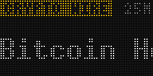

**Videos** shows new uploads from YouTube channels you pick, the same way as news: the title scrolls
with the channel name in a red tag and the video's age. On the phone page, turn on **YouTube
videos** under Screens, then paste channel links (`youtube.com/@name`, `/channel/UC…` or a feed
URL), one per line. The Pi turns each into the channel's free feed
(`youtube.com/feeds/videos.xml?channel_id=…`); an `@handle` is looked up once on the channel's page
and remembered in `cache/youtube_channels.json`. Under each channel the page shows ✓ and its name
once it has been read, or what went wrong. Channels are checked every 30 minutes; each keeps its
last good uploads, and uploads older than the age limit drop off even while YouTube is unreachable.
Shorts are skipped by default.

Scrolling moves one pixel per frame, and the position follows the clock, so a late frame never
slows the text down. Building a frame is a copy plus a crop-and-paste of a pre-rendered strip:
`python tools/bench_scroll.py` measures it (about 0.02 ms per frame on a desktop CPU against a
22 ms budget at the fast speed). Run it on the Pi (`sudo ./venv/bin/python tools/bench_scroll.py --panel`)
to see real numbers there.

**Sports** shows NFL, college football, NBA, men's college basketball and MLB (NHL is in the list,
off by default). For each sport the ticker follows the **top teams** (the AP Top 25 for college,
the best records for pro leagues; adjustable) and your **favorites** (search and tap on the phone
page). A game is shown if either team is followed:

1. live games: score, period or inning, and clock (red)
2. finals from the last 24 hours (grey)
3. the next game for each favorite: day and time (yellow), with records

Teams show as abbreviations with a team-color bar, `#7` for a ranking and ★ for a favorite. A line
that doesn't fit scrolls like a headline. Sports out of season are skipped and hidden on the phone
page. Data is ESPN's public scoreboard, rankings and standings JSON (unofficial; no key), fetched
every 60 seconds while a followed game is live and every 15 minutes otherwise. Each sport keeps its
last good data; if ESPN fails or changes its format, that sport is skipped. Live scores older than
3 minutes get the red stale dot.

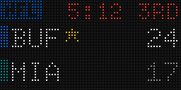

Adding a league is one line in the `LEAGUES` table in `sports.py` (ESPN path, name, whether it has
AP rankings, season months, default on/off, default top teams, tag color).

## Phone settings page

1. On your phone (same Wi-Fi), open `http://<hostname>.local:8080`. `install.sh` prints the address.
2. Enter your PIN. Five wrong PINs lock the page for 5 minutes.
3. In Safari: **Share → Add to Home Screen** for an app icon.

You can search and add coins (with rank and icon, so you pick the real one), reorder, star (★),
turn on **Focus** and **List view**, change layout, transition (Scroll / Slide / None), brightness, time per coin, night dimming,
screens (on/off and order), news feeds and speed, sports and favorite teams, weather location,
currency and refresh rate. Changes show on the panel within seconds.

Every value is checked on the Pi before it's saved (ranges, allowed choices, coin-id format,
time zones, coordinates), and nothing is written unless all fields pass; the page shows which
field was wrong. Bad hand edits in `settings.env` don't break the page either.
The page is only reachable on your home network.

At the bottom, **Status** shows when prices were last fetched, how long the ticker and the Pi
have been running, the Wi-Fi signal (from `/proc/net/wireless`), and the last error, if any.
**Software** shows the installed version with **Update** and **Roll back** buttons
(see [Updating](#updating-and-rolling-back)).

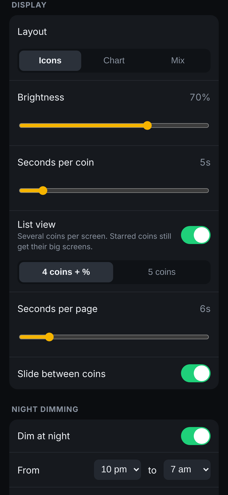
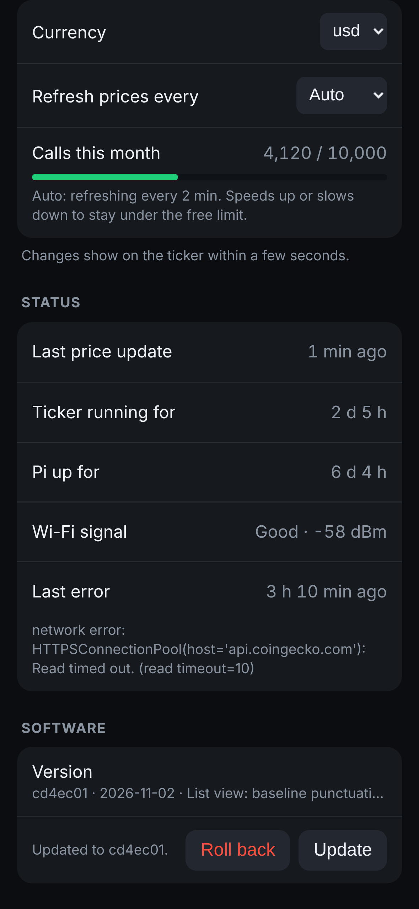

## Updating (and rolling back)

Tap **Update** on the phone page. The Pi then:

1. refuses if code files in the ticker folder were edited by hand (`settings.env`, your icons,
   logs and caches don't count);
2. fetches the latest code from GitHub **over SSH with a deploy key** and fast-forwards to it,
   remembering the previous version;
3. if `requirements.txt` changed, saves a list of the installed packages and installs the new ones
   **before restarting**. If that fails, the code and the packages are both put back;
4. runs `ticker.py --check` on the new code (imports everything, reads your settings). If that
   fails, the previous version is restored and nothing restarts;
5. if `launcher.py` changed, runs the new launcher's `--self-check` and only then installs it;
   otherwise the old launcher stays in use (it's the safety net, so it must never be broken);
6. restarts the service. If the new version fails to start **3 times in a row**, the launcher
   restores the previous version (and packages) by itself. After the new version has run for a
   minute, it's marked good.

**Roll back** puts the previous version back (code, packages if they changed, and launcher) and
restarts. It's available after an update until you roll back.

### Deploy key (needed once the repo is private)

The Update button pulls over SSH as the folder's owner using a read-only **deploy key**.
`install.sh` creates one and prints it. To set it up later or on its own:

```bash
cd ~/crypto-ticker
./install.sh --deploy-key
```

It prints a line starting with `ssh-ed25519`. On GitHub, open the repo →
**Settings → Deploy keys → Add deploy key**, paste it, leave **Allow write access** off, and save.
Then tap **Update** again. To test it from the Pi:

```bash
ssh -i ~/.ssh/crypto-ticker-deploy -o IdentitiesOnly=yes -T git@github.com
```

GitHub answers "Hi …! You've successfully authenticated, but GitHub does not provide shell
access." If the key is missing or not added, the phone page says
**"Pi can't reach GitHub — deploy key needed"** and shows the public key to add.
A Pi that's offline gets "check its internet connection" instead.

Updating by hand over SSH still works (`git pull`, then `./install.sh --skip-build` to refresh the
installed launcher, then restart). For a private repo, give git the key first:
`git remote set-url origin git@github.com:<owner>/crypto-ticker.git` and add the key to
`~/.ssh/config` or use `GIT_SSH_COMMAND="ssh -i ~/.ssh/crypto-ticker-deploy"`.

## iPhone widget

`iphone/CryptoTicker.js` is a widget for the free **Scriptable** app. It fetches its own data,
so it works away from home. Install Scriptable, tap **+**, paste the whole file and name it
"Crypto Ticker". Add a Scriptable widget, long-press → **Edit Widget**, choose the script and
set **Parameter**:

| Parameter | Shows |
|--|--|
| `coins:btc` | One coin (home screen, StandBy, lock screen) |
| `coins:btc,ada,snek` | Several coins: medium widget shows 3; lock-screen inline rotates one per refresh; rectangular shows 2 |
| `news:https://example.com/feed.xml` | Latest headline from an RSS or Atom feed; tap opens the article |
| `btc,ada` | Old form, still works (same as `coins:`) |

Lock-screen widgets: **inline** (one line above the clock), **circular** (symbol, ▲/▼ and a ring
gauge of the 24h change), **rectangular** (one coin with a sparkline, two coins, or a headline
with source and age). They're monochrome, so direction is always shown with ▲/▼. If a fetch fails,
the last good data is shown and marked "offline" (or "OLD" in the small circular widget). The comments
at the top of the script have more setup examples. iOS decides when widgets refresh
(usually every 15–30 minutes).

## Running without hardware (emulator)

```bash
python3 -m venv venv && . venv/bin/activate
pip install -r requirements-dev.txt
python ticker.py --emulate --sample        # made-up prices, no network needed
python ticker.py --emulate                 # live prices
```

Open **http://localhost:8888** to watch the emulated panel (and http://localhost:8080 for the
settings page). Other emulator outputs: `--emulator-adapter pygame` (desktop window),
`terminal`, `tkinter`. Emulator look (pixel size, style) is in `emulator_config.json`.

Screenshots (see [Screenshots](#screenshots)):

```bash
python screenshots.py                      # panel screens + panel-contact-sheet.png
node tools/settings_screenshots.mjs        # phone settings page at iPhone size (Playwright)
node tools/widget_screenshots.mjs          # iPhone widget variants (Playwright)
```

Animated GIF preview: `python preview.py --sample` (writes `preview.gif`). `screenshots.py` also
writes `docs/preview-scroll.gif`, the scroll transition made by the real `Ticker.show()` code.

## How failures are handled

- **Timeouts, Wi-Fi loss, server errors (5xx):** each request is retried up to 3 times with
  exponential backoff (about 1 s, 2 s). If that fails, the ticker keeps showing the **last good
  prices with a small red dot in the bottom-right corner** (the "stale" marker) and tries again
  after 30 s, 1 min, 2 min, 4 min… up to 10 min. Fetching runs in the background, so the
  display never freezes.
- **Rate limit (HTTP 429):** not retried on the spot. The ticker waits at least as long as
  CoinGecko's `Retry-After` header asks (min 1 min, backing off up to 30 min).
- **Malformed JSON or odd data:** bad rows are skipped; if nothing usable came back it's treated
  as a failed refresh (stale marker), never a crash.
- **No data at all:** after a reboot without internet, the last good prices are loaded from
  `cache/requests.json` and shown as stale. With no cache either, a `NO DATA` screen says why
  (`NO NETWORK?`, `RATE LIMIT`, `BAD DATA`).
- **Request cache:** identical requests within 50 s (prices) or 1 h (coin search) are served
  from memory without spending API calls. The disk copy is written at most every 5 minutes to
  spare the SD card.
- **Logs:** console/journal plus a rotating file (`logs/ticker.log`, 512 KB × 4 files); the
  system journal is capped at 16 MB by `install.sh`.

## Troubleshooting

**First, run the health check and paste its output when asking for help:**

```bash
cd ~/crypto-ticker
./doctor.sh
```

It prints a short report: OS and Pi model, Wi-Fi network and signal, internet access, whether
CoinGecko, Open-Meteo, ESPN, GitHub and each news feed can be reached, the service status and its
last 30 log lines (errors marked `!!`), free disk space and memory, the panel settings, and whether
the deploy key works. Each line is OK, WARN or FAIL with a one-line fix. It never changes anything
and never prints passwords, the PIN or API keys. If it can't read the log, run `sudo ./doctor.sh`.

| Problem | What to do |
|--|--|
| Panel blank, service running | `journalctl -u crypto-ticker -n 50`. Did you reboot after install (audio must be off)? Run `--test-pattern` |
| Flicker / garbled pixels | Raise `LED_SLOWDOWN_GPIO` by 1, restart. Soldering the PWM jumper also helps |
| Service keeps restarting | `journalctl -u crypto-ticker -b` shows the error. `ModuleNotFoundError: rgbmatrix` → run `./install.sh` without `--skip-build` |
| `NO DATA / NO NETWORK?` | Pi isn't online: `ping -c3 api.coingecko.com`. Pi Zero W needs 2.4 GHz Wi-Fi |
| `NO DATA / RATE LIMIT` or the red stale dot often | Use `REFRESH_RATE=auto`, add a free CoinGecko Demo key. The phone page shows this month's call count |
| Red dot in the corner | Prices couldn't be refreshed; they're the last good ones. Check the log for why |
| Wrong coin for a ticker | Pin it: `SYMBOLS=btc,uni:uniswap` |
| Can't open the phone page | Same Wi-Fi? Try the Pi's IP (`hostname -I`). Check `WEB_ENABLED=true` and the log |
| Doesn't join the work Wi-Fi | `journalctl -u NetworkManager -b \| grep -i 802-1x`: a certificate error means the CA file or domain doesn't match (ask IT); an authentication failure means the username/password. Re-run `./install.sh --enterprise-wifi` to fix them |
| Can't open the settings page at work | Expected on many company networks (devices can't see each other). Change settings at home |
| Forgot the PIN | Edit `WEB_PIN` in `settings.env`, then `sudo systemctl restart crypto-ticker` |
| "Pi can't reach GitHub — deploy key needed" | Set up the [deploy key](#deploy-key-needed-once-the-repo-is-private) |
| "The SSH client is missing" | `sudo apt-get install -y openssh-client` |
| "Files … were edited by hand" on Update | `git status` shows what; `git stash` or `git checkout -- <file>`, then update |
| "The update didn't start … restored automatically" | The new version crashed at startup; you're back on the old one. `journalctl -u crypto-ticker -b` shows why |
| Wrong time on the clock | Set `TIMEZONE` (or the location on the phone page); check `timedatectl` |
| SD card filling up | `du -sh logs cache`; lower `LOG_MAX_KB` / `LOG_BACKUPS` |
| Weather screen never shows | It needs weather data: check the location on the phone page and the log for "Weather fetch failed" |
| News screen never shows | No feed has worked yet: open a feed URL in a browser to check it, and look for "news feed … failed" in the log |
| Videos screen never shows | No upload in the age window, or no channel has worked yet: the phone page shows a ⚠ under a channel that failed; look for "videos:" in the log. A wider "Only videos from the last" setting helps for channels that post rarely |
| Sports screen never shows | No followed game in the last 24 h or upcoming, the sport is out of season, or ESPN failed ("sports … failed" in the log). Add a favorite to always see its next game |
| Focus on but every coin shows | No coin is starred; tap ★ on the phone page (the page shows a hint) |

## Development

```bash
pip install -r requirements-dev.txt
pytest                      # Python tests (mocked APIs, no network or hardware)
node --test tests/widget/widget.test.mjs   # iPhone widget tests (also run by pytest if Node is installed)
```

The tests mock CoinGecko responses: normal data, timeouts, HTTP 429, HTTP 5xx, malformed JSON,
Wi-Fi loss, cold start offline, plus settings-page validation, Focus/List view, log rotation and
the emulator. Weather, news, videos and sports have their own mocked-data tests (normal, empty, malformed,
offline; for sports also live/final/upcoming for every league), plus scroll timing and transitions. The widget tests run the Scriptable script against a small stand-in for
Scriptable's API (`tests/widget/scriptable_stub.mjs`), not the real app.

| File | Role |
|--|--|
| `ticker.py` | Main loop, config, background refresh with backoff, screens, Focus/List view |
| `prices.py` | CoinGecko client: retries, typed errors, tolerant parsing, cache |
| `cache.py` / `retry.py` / `logsetup.py` | Request cache, backoff helpers, rotating logs |
| `render.py` | Draws every screen as a Pillow image |
| `display.py` | Real panel, emulator (with screenshots) or GIF recorder |
| `webui.py` | Phone settings page with input validation |
| `news.py`, `videos.py`, `sports.py`, `scroller.py` | News feeds, YouTube uploads, ESPN scores and the league table, scrolling text |
| `feeds.py`, `session.py`, `usage.py`, `icons.py`, `bdf.py` | Weather/F&G/indices, market sessions, API budget, icons, fonts |
| `install.sh`, `crypto-ticker.service` | Install and auto-start |
| `wifi_enterprise.py` | Extra Wi-Fi profiles for `install.sh --enterprise-wifi`, `--add-wifi`, `--list-wifi` |
| `doctor.sh`, `doctor.py` | Read-only health check |
| `launcher.py`, `updater.py`, `sysinfo.py` | Service entry point + update safety net, Update/Roll back, Wi-Fi and uptime |
| `tools/` | Demo settings server, Playwright screenshot scripts, scroll frame-time benchmark |
| `screenshots.py`, `preview.py`, `sample.py` | Emulator screenshots, GIF preview, sample data |
| `iphone/CryptoTicker.js` | Scriptable widget |

Price data from [CoinGecko](https://www.coingecko.com/en/api). Icons from CoinGecko, with
[spothq/cryptocurrency-icons](https://github.com/spothq/cryptocurrency-icons) as a fallback.
LED driver: [hzeller/rpi-rgb-led-matrix](https://github.com/hzeller/rpi-rgb-led-matrix).
Emulator: [RGBMatrixEmulator](https://github.com/ty-porter/RGBMatrixEmulator).
Weather from [Open-Meteo](https://open-meteo.com/). Scores from ESPN's public site API (unofficial).

## Screenshots

All in [`docs/screenshots/`](docs/screenshots/). Panel screens are rendered by RGBMatrixEmulator
with sample data. The settings page is the real page in headless Chromium at iPhone size, with
sample data. Widget images are **approximate**: the real script runs against a stand-in for
Scriptable and is drawn as HTML (fonts, spacing and icons differ from iOS).

| | |
|--|--|
| Every panel screen | `panel-contact-sheet.png` (individual screens: `01-…` to `19-…`) |
| Animations | `../preview-scroll.gif`, `../preview-news.gif`, `../preview-sports.gif` |
| Settings page (iPhone) | `settings-page-iphone-full.png`, `-top`, `-screens`, `-news`, `-sports`, `-list-view`, `-indices`, `-status-update`, `-deploy-key` |
| iPhone widget | `widget-contact-sheet.png`, `widget-coins-*.png`, `widget-news-*.png` |

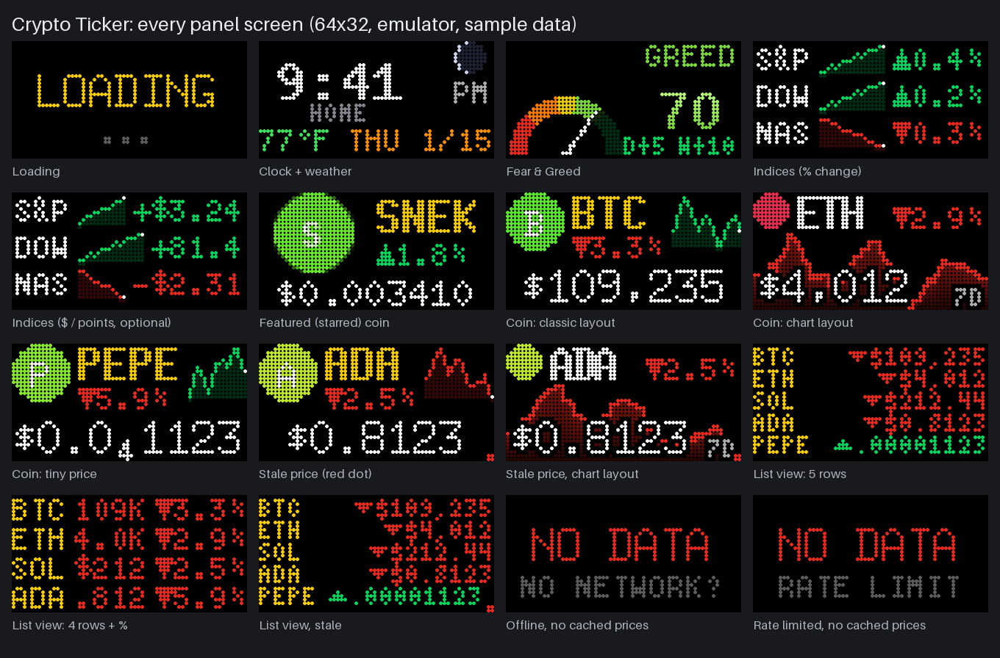
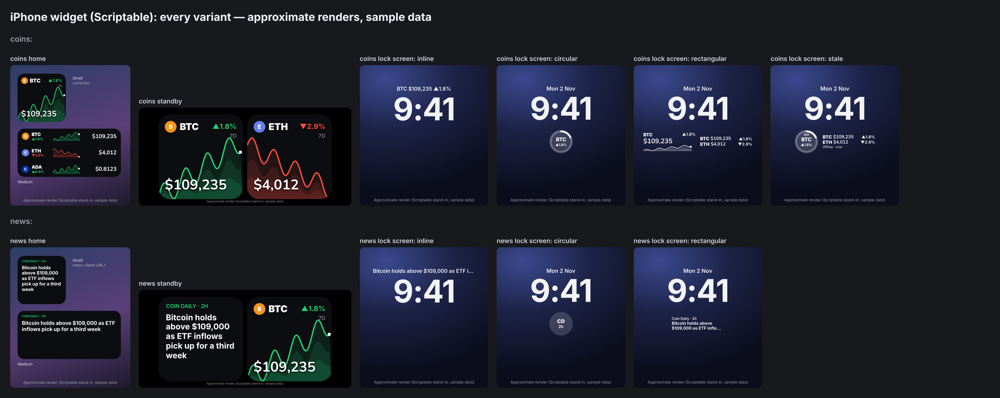
